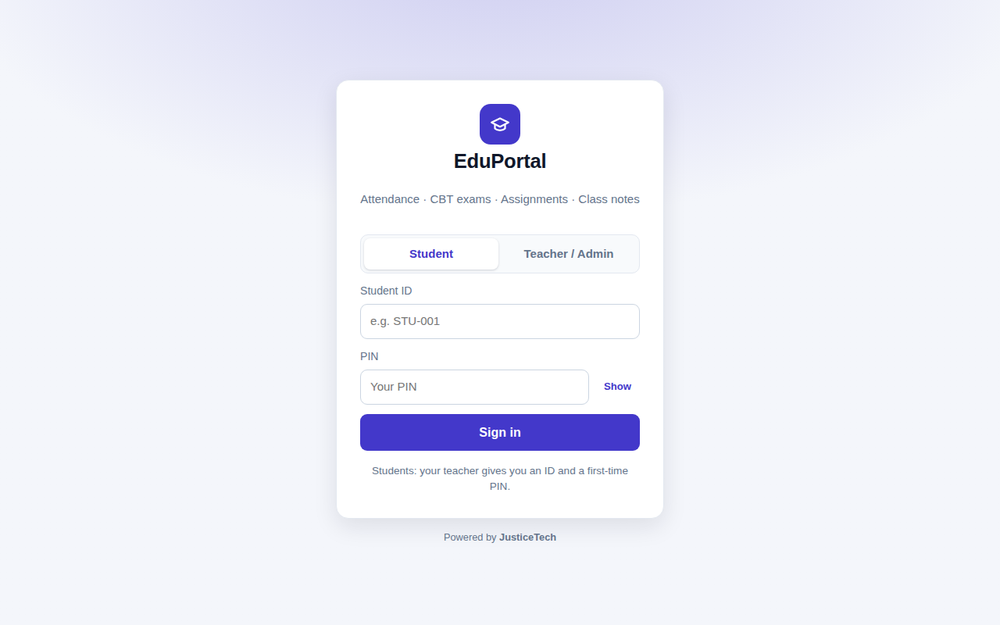
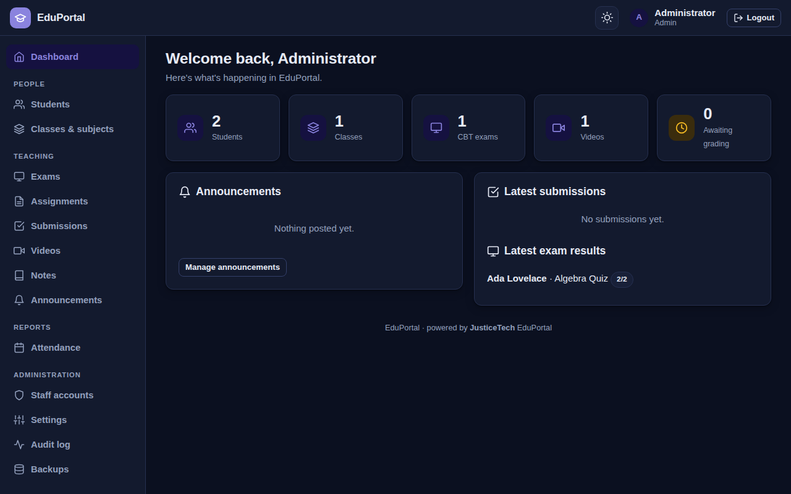
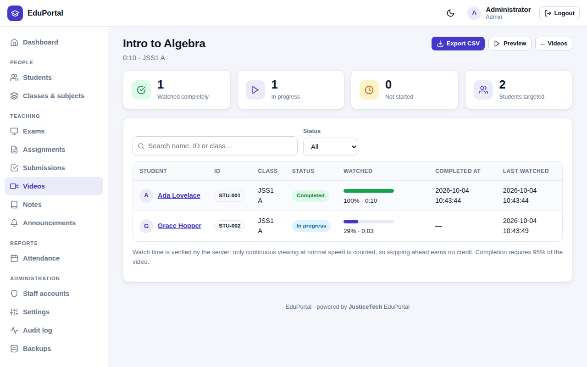
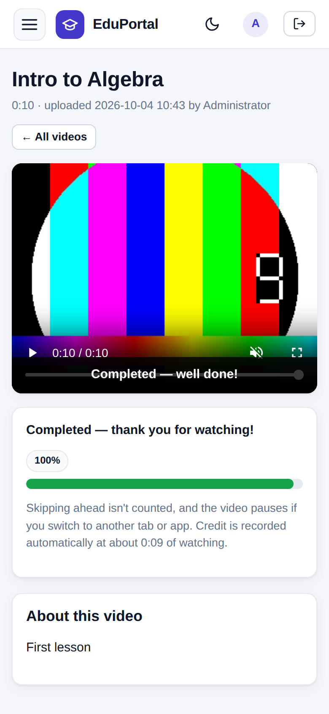
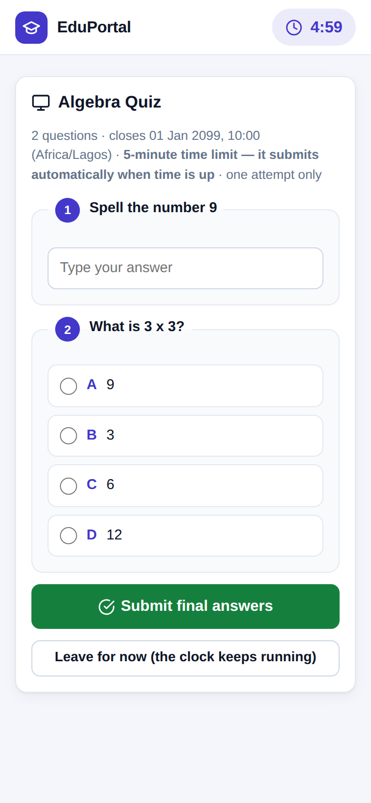

# 🎓 EduPortal

A complete classroom portal for teachers and students: **attendance, timed CBT exams, assignments, video lessons with verified watch tracking, grading, notes, announcements, report cards and more** — in one lightweight Flask + SQLite app.

It runs **locally on your Wi‑Fi / LAN** *or* **hosted on the internet** for anyone with the link, from the same code. No CDN, no build step, no external services.

<p align="center">
  
  
</p>
<p align="center">
  
  
  
</p>

---

## Contents
[Features](#features) · [GitHub Pages cannot run this](#important-github-pages-cannot-run-this-app) · [Quick start (local / LAN)](#quick-start-local--lan) · [First steps](#first-steps) · [Video lessons](#video-lessons-and-watch-tracking) · [Host it on the internet](#host-it-on-the-internet) · [Configuration](#configuration) · [Backups](#backups--restore) · [Security](#security-notes) · [Troubleshooting](#troubleshooting) · [Tests](#running-the-tests) · [Structure](#project-structure)

---

## Features

**Teaching**
- **Classes & subjects** — aim exams, assignments, notes, videos and announcements at one class or everyone
- **CBT exams** — multiple choice, true/false and short-answer questions, optional pictures, points per question, CSV import, **time limit with auto‑submit**, shuffled questions/options, one attempt (teacher can allow a retake), **answer review** (after submit / after deadline / never)
- **Assignments** — attachments, deadlines, **late policy** (reject / accept & flag / accept with % penalty), grading with feedback
- **Video lessons** — upload once, students stream it in the browser; see **exactly who watched it to the end** (full name, class, ID, % watched, when)
- **Announcements** (pinned, per class), **class notes & resources**

**People & records**
- **Per‑student PIN** (temporary PIN generated, student chooses their own at first sign‑in), bulk **CSV import**, profile **photos**
- **Multiple teachers + admin role**, deactivate instead of delete (keeps history)
- **Attendance reports by date range** and class, with attendance %
- **Student results page** with score‑history chart and **PDF report card** (print view too)
- **CSV exports** for students, attendance, exam results, grades and video viewing
- **Audit log** of every important action (who / what / when / from where)

**Platform**
- **Settings screen** for school name, logo, accent colour, timezone, video completion rule — no files to edit
- **Dark mode**, fully responsive (phone‑first), **installable PWA** with offline fallback page
- **Automatic daily database snapshots** + one‑click full backup download
- Works completely **offline on a LAN**, strict CSP, CSRF protection, login throttling, safe uploads

---

## Important: GitHub Pages cannot run this app

EduPortal is a **Python (Flask)** application. GitHub Pages only serves *static* files, so it can't execute Python — you would see raw `` tags and a **405** error on login. Keep your code on GitHub, but **run** it locally (below) or on a host that runs Python (see [Host it on the internet](#host-it-on-the-internet)).

---

## Quick start (local / LAN)

Requires **Python 3.9+**.

```bash
python -m venv .venv
# Windows:  .venv\Scripts\activate        macOS/Linux:  source .venv/bin/activate
pip install -r requirements.txt

cp .env.example .env      # optional: set TEACHER_PASSWORD (the first admin password)
python app.py
```

The terminal prints the exact addresses:

```
Open on THIS computer:
   http://localhost:5000

Share with phones/laptops on the SAME Wi-Fi / LAN cable:
   http://192.168.1.23:5000   <-- give students this link
```

- Everyone must be on the **same network** (same Wi‑Fi, or cable to the same router/switch).
- If port 5000 is busy (macOS uses it for AirPlay) the next free port is chosen and printed.
- `python app.py --port 8080` · `python app.py --local-only` (this computer only) · `python app.py --reset-admin-password`.

**First sign‑in:** username **`admin`**. The password is your `TEACHER_PASSWORD`; if you didn't set one it is `admin123` and the portal forces you to change it immediately.

---

## First steps

1. Sign in as **admin** (choose *Teacher / Admin*).
2. **Settings** → set the school name, logo, colour and **timezone** (deadlines, attendance and exam clocks use it).
3. **Classes & subjects** → add your classes.
4. **Students** → add students one by one or **import a CSV** (`full_name, student_id, class`). A temporary PIN is shown **once** — print the sheet or download it as CSV and hand them out.
5. Optional: **Staff accounts** → add teachers (they get a temporary password and choose their own).
6. Post exams, assignments, notes, videos and announcements.

Students sign in with **Student ID + PIN**, choose their own PIN, and land on a dashboard of what's due. Teachers can reset a PIN any time (*Students → Edit → Reset PIN*).

---

## Video lessons and watch tracking

Upload an **MP4 (H.264/AAC)** or **WebM** under *Videos*. The browser reads the length before upload and shows a progress bar; if `ffprobe` (part of FFmpeg) is installed on the server it is used to confirm the length.

- Playback uses HTTP range requests, so seeking and phones work properly.
- Teachers open **Who watched** to see every targeted student: full name, ID, class, status (*Completed / In progress / Not started*), % watched, completion time and last activity. Filter, search, or export CSV.
- A video counts as **watched completely** at 95 % by default (change in Settings).

**How tracking is verified (and its limits).** The browser sends the playhead position every few seconds; **the server decides what counts**. Time is credited only when the playhead advances continuously by no more than the real time that passed, so skipping ahead, jumping to the end or speeding up earns nothing. The player also blocks skipping ahead, locks speed at 1×, and pauses when the tab is hidden. No browser‑based system can be 100 % tamper‑proof — a determined student could script real‑time requests without actually watching — but casual cheating (scrubbing to the end, fast‑forwarding) does not work.

**Tips**
- Encode for fast start: `ffmpeg -i in.mov -c:v libx264 -c:a aac -movflags +faststart out.mp4`.
- Upload size is limited by `MAX_VIDEO_MB` (default 500) **and by your host/proxy** — many hosts cap request sizes. On a LAN there is no such limit.
- Videos live in `data/uploads/videos` and are included in backups only if you tick *Also include videos*.

---

## Host it on the internet

Any host that runs a Python web process works. The app reads `PORT` and ships a `Procfile` (`gunicorn`) and `render.yaml`.

### ⚠️ Persistent storage is mandatory

Data lives in **`DATA_DIR`** (SQLite database, uploads, videos, backups). Many hosts give web apps a **temporary disk that is wiped on restart/deploy** — students, exams and videos would vanish. Put `DATA_DIR` on a **persistent disk/volume**, or use a host with a permanent filesystem. Persistent disks are often a paid feature — check your provider's current plans.

### Option A — Render (`render.yaml`)
1. Push the project to GitHub → Render **New → Blueprint** → pick the repo.
2. Set `TEACHER_PASSWORD` and `PORTAL_TIMEZONE` when prompted.
3. Attach a **persistent disk** mounted at `/var/data` (the blueprint already sets `DATA_DIR=/var/data`).
4. Open your URL, sign in as `admin`.

### Option B — PythonAnywhere (permanent filesystem)
1. Upload/clone the project; run `pip install --user -r requirements.txt`.
2. **Web** → *Add a new web app* → *Manual configuration* (Python 3.9+).
3. In the WSGI file:
   ```python
   import os, sys
   sys.path.insert(0, "/home/YOURNAME/eduportal")
   os.environ["TEACHER_PASSWORD"] = "choose-a-strong-password"
   os.environ["PORTAL_TIMEZONE"] = "Africa/Lagos"
   os.environ["TRUST_PROXY"] = "1"
   os.environ["COOKIE_SECURE"] = "1"
   from app import app as application
   ```
4. Reload. (Request‑size limits there may restrict large video uploads.)

### Option C — VPS / Railway / Fly.io
`gunicorn app:app --workers 1 --threads 8 --bind 0.0.0.0:$PORT --timeout 300`, a mounted volume, HTTPS, and the variables below (`TRUST_PROXY=1`, `COOKIE_SECURE=1`).

> **Keep `--workers 1`.** SQLite is happiest with one process and several threads — the right setup for a classroom.

### PWA / offline
On an **HTTPS** site (or `localhost`) browsers offer *Install app* and the portal caches its look‑and‑feel and shows a friendly offline page. Over plain `http://192.168…` LAN addresses browsers don't allow installation or service workers — everything else works normally. Signed‑in pages are never cached, so nothing private is stored on shared devices.

---

## Configuration

Most things are in **Settings** inside the portal. Environment variables (or a local `.env`) cover deployment:

| Variable | Default | Purpose |
|---|---|---|
| `TEACHER_PASSWORD` | `admin123` (forced change) | First‑time password for user `admin`. Only used when the database is created. |
| `SECRET_KEY` | auto‑generated & saved | Signs sessions. Set a fixed value on hosts with temporary disks. |
| `PORTAL_TIMEZONE` | server time | Default timezone (editable in Settings). |
| `DATA_DIR` | `./data` | Database, uploads, videos, backups. **Use persistent storage when hosted.** |
| `PORT` | `5000` (auto if busy) | Listening port. Hosts set this. |
| `MAX_UPLOAD_MB` / `MAX_VIDEO_MB` | `25` / `500` | Size limits for documents / videos. |
| `TRUST_PROXY` | off | `1` behind an HTTPS proxy. |
| `COOKIE_SECURE` | off | `1` when served over HTTPS. |

**Upgrading from an earlier version?** Keep your `data/` folder (or put the old `classroom.db` and `uploads/` next to `app.py`) and start the new version once — tables are migrated automatically and nothing is lost. Existing students have no PIN yet: they sign in with their ID alone **once** and are made to choose a PIN (or reset theirs first from *Students*). The old teacher password no longer applies — sign in as `admin` (see *First sign‑in*).

---

## Backups & restore

*Admin → Backups*: **download a full backup (.zip)** of the database and uploads (videos optional), take a snapshot now, or rely on the **automatic daily snapshot** (last 14 kept by default; triggered by portal traffic, so it works on any host).

Snapshots sit on the *same disk* as the portal — **download a full backup regularly and store it elsewhere.**

Restore: stop the portal → replace `data/classroom.db` with the backup's `classroom.db` → copy the backup's `uploads/` over `data/uploads/` → start again.

---

## Security notes

- Passwords and PINs are stored **hashed**; temporary ones are shown once. Admins can reset them; the **audit log** records who did what.
- Every state‑changing action is a CSRF‑protected `POST`; repeated failed logins are throttled per IP and per account.
- Uploads: allow‑listed types, safe renaming, images verified by content, downloads served as attachments; students only reach their own submissions and their own class's content.
- Strict Content‑Security‑Policy, no inline scripts, no third‑party requests.
- **Hosted:** serve over **HTTPS**, set `COOKIE_SECURE=1`, choose a strong admin password.

---

## Troubleshooting

**Other devices can't open the LAN link** — same Wi‑Fi/router? Guest networks often block device‑to‑device traffic. *Windows:* allow Python on **Private networks** in the firewall prompt (or *Windows Security → Firewall → Allow an app*). *macOS:* allow incoming connections. *Linux:* `sudo ufw allow 5000/tcp`. Use the **network address** printed in the terminal, not `localhost`. Several adapters (Wi‑Fi + Ethernet + VPN)? All are listed — use the one on the classroom network.

**Can't sign in as admin** — username is `admin`. Forgot the password: `python app.py --reset-admin-password`.

**Student can't sign in** — check the ID, then *Students → Edit → Reset PIN* and give them the new temporary PIN. Too many failures lock an ID for ~15 minutes.

**Video won't play** — re‑encode to MP4 with H.264 video + AAC audio (see tip above).

**Upload fails on the hosted site** — your host/proxy request‑size limit is lower than the file; compress the video, or upload on the LAN version.

**Deadlines look wrong** — set the timezone in *Settings*.

**Data disappeared after a redeploy** — temporary disk; see *Persistent storage is mandatory* above.

---

## Running the tests

```bash
python -m unittest discover -s tests -t . -v
```

Covers sign‑in/PIN flows, roles, class targeting, all exam types, timers, video streaming (HTTP ranges) and watch‑tracking rules, late policies, reports/PDF, backups, settings, PWA endpoints, upload hardening and upgrading from the original database. (The video tests need FFmpeg installed to generate a sample clip.)

---

## Project structure

```
eduportal/
├── app.py                 # entry point + local/LAN launcher (gunicorn app:app for hosting)
├── portal/
│   ├── __init__.py        # app factory
│   ├── config.py db.py security.py utils.py services.py backups.py
│   └── routes/            # auth, main, people, academics, videos, reports, admin
├── templates/             # Jinja templates
├── static/                # css, js, icons, service worker, bundled fonts (for PDFs)
├── tests/                 # end-to-end tests
├── requirements.txt  Procfile  render.yaml  .env.example
├── docs/                  # screenshots
└── data/                  # created at runtime (git-ignored): classroom.db, uploads/, backups/
```

<p align="center">Built by <strong>JusticeTech</strong></p>
